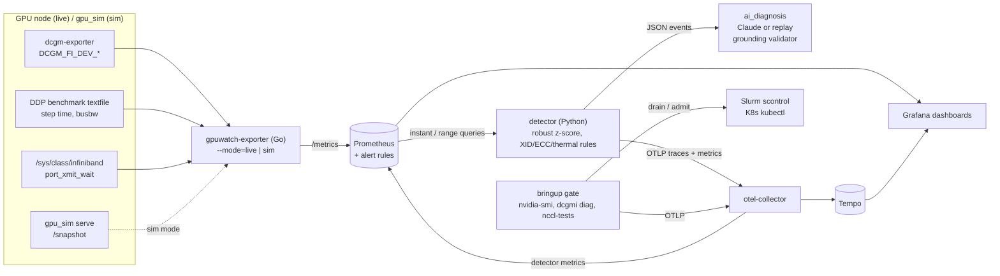
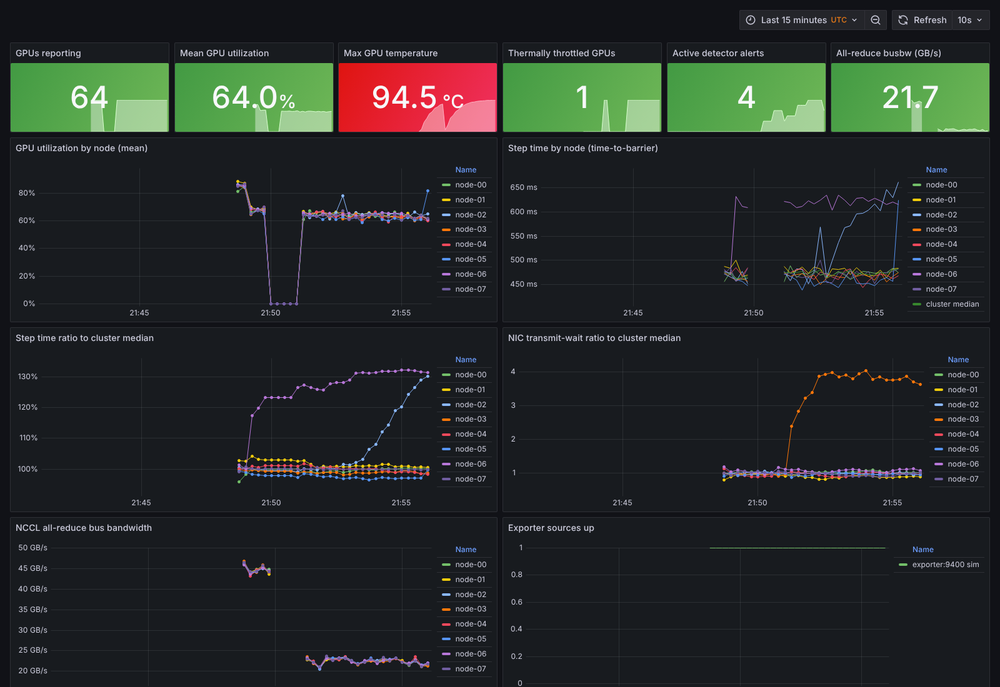
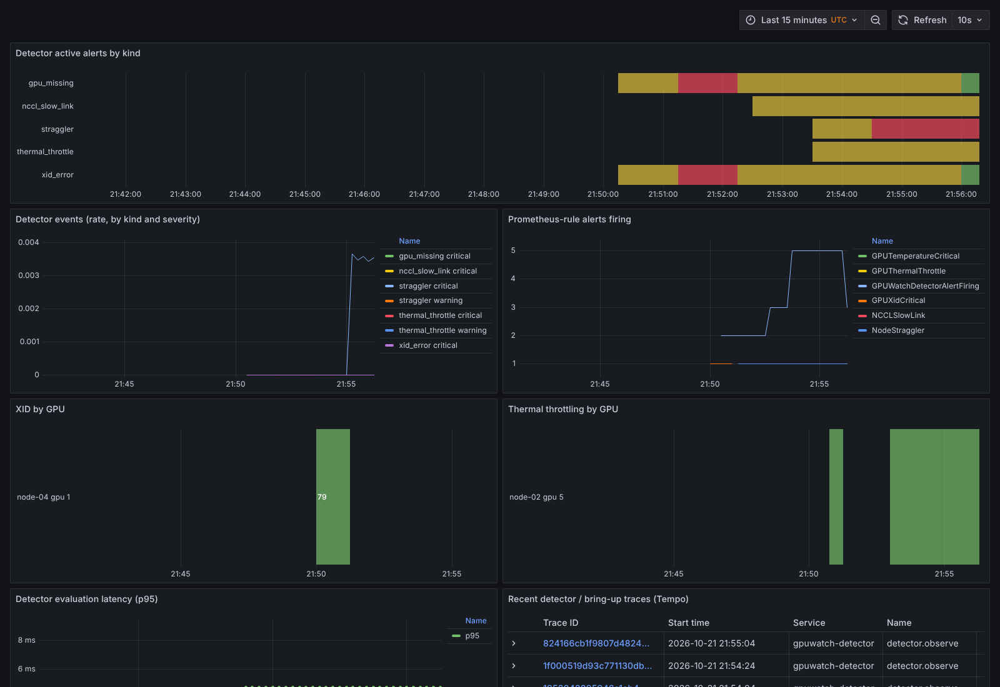

# GPUWatch

GPU cluster telemetry, fault detection, and node health gating for distributed training.

> **Status: everything in CI runs against a deterministic simulator. Nothing in this
> repository has been run on real GPUs, Slurm, or Kubernetes yet.** The live backends are
> real code paths (DCGM / dcgm-exporter, nvidia-smi, nccl-tests, scontrol, kubectl,
> InfiniBand sysfs, the Anthropic API) that are exercised in CI only through fakes and
> simulated tool output. Every component marked **NOT VERIFIED IN CI** below needs a run
> on real hardware before it can be trusted. See [Running live](#running-live-on-real-gpus).

## What it does

| Component | Dir | Lang | `sim` backend | `live` backend | Status |
|---|---|---|---|---|---|
| Cluster simulator | [`gpu_sim/`](gpu_sim) | Python | N nodes x G GPUs, DCGM-style metrics, kernel/NCCL log lines, seeded fault injectors (thermal, XID 79, ECC burst, straggler, network) | - | tested in CI |
| Prometheus exporter | [`exporter/`](exporter) | Go | serves simulator snapshots under DCGM metric names | proxies dcgm-exporter, merges workload textfiles, derives NIC throughput / xmit-wait from IB sysfs | sim + parsers tested in CI; live **NOT VERIFIED IN CI** |
| Detector | [`detector/`](detector) | Python | consumes simulator snapshots | queries Prometheus (follow or backfill) | tested in CI; also ran end-to-end via Prometheus in the compose stack |
| Bring-up gate | [`bringup/`](bringup) | Python | simulated node renders nvidia-smi / dcgmi / gpu_burn / nccl-tests output; fake scontrol / kubectl | runs the real tools; drains via scontrol / kubectl (dry-run by default) | tested against fakes; live **NOT VERIFIED IN CI** |
| Tracing | [`tracing/`](tracing), [`docker-compose.yml`](docker-compose.yml) | Python / YAML | OTLP -> otel-collector -> Tempo + Prometheus, Grafana | same | in-memory + OTLP/HTTP export tested in CI |
| AI diagnosis | [`ai_diagnosis/`](ai_diagnosis) | Python | replay backend (hand-authored fixtures) | Anthropic API (`claude-opus-5-5`, structured JSON output) | grounding validator tested in CI; API path tested with a mocked client only |
| Dashboards + alerts | [`dashboards/`](dashboards) | JSON / YAML | - | - | JSON validated, alert rules unit-tested with promtool |
| Deploy | [`deploy/`](deploy) | Helm / Slurm / Terraform / bash | - | - | lint / template / validate only: **NOT VERIFIED IN CI** |
| Evaluation | [`eval/`](eval) | Python | fault-injection eval over seeded runs | - | runs in CI as a gate |
| Runbook | [`runbook.md`](runbook.md) | - | - | - | top 5 failures |

## Architecture



Data flow: the exporter normalises everything to DCGM metric names plus three
`gpuwatch_*` job/network metrics ([contract](exporter/metrics_contract.txt), checked by
tests in both Go and Python). Prometheus stores it; the detector builds a cluster
*snapshot* per scrape interval and keeps sliding windows; events are JSON lines with
evidence; the AI summarizer turns one event plus correlated metrics/logs into a cited
hypothesis. The bring-up gate is independent: it runs before a node joins the pool.

## Results (simulated)

`make eval` injects each fault type into many seeded simulations plus a set of healthy
runs and scores the detector. The table below is generated by `make eval` (do not edit it
by hand); the full report with severity breakdowns, misses and false positives is in
[`docs/results.md`](docs/results.md). **These are simulator results, not measurements on
GPUs**: they show the detector works against the simulator's fault model, and where its
sensitivity floor is. Real hardware will have noise and failure modes the simulator
does not model.

<!-- EVAL:BEGIN (generated by `make eval`; do not edit) -->
| Fault type (simulated) | Runs | Detection rate | Healthy-run FP rate | TTD median (sim s) | TTD p90 (sim s) | TTD max (sim s) |
|---|---:|---:|---:|---:|---:|---:|
| thermal | 100 | 100.0% (100/100) | 0.0% (0/200) | 103.9 | 136.6 | 172.2 |
| xid | 100 | 100.0% (100/100) | 0.0% (0/200) | 5.3 | 8.8 | 9.8 |
| ecc | 100 | 99.0% (99/100) | 0.0% (0/200) | 5.7 | 16.2 | 70.6 |
| straggler | 100 | 92.0% (92/100) | 2.5% (5/200) | 75.2 | 112.5 | 1152.5 |
| network | 100 | 99.0% (99/100) | 0.0% (0/200) | 45.1 | 49.7 | 377.4 |

Healthy runs with >= 1 event of any kind (simulated): 5/200 (2.5%); 6 false events total = 0.06 per simulated hour.
<!-- EVAL:END -->

How it is scored (details in [`eval/run.py`](eval/run.py)): a fault counts as detected
when a firing event of the expected kind names the faulted node (and GPU, for GPU-scoped
faults) at or after onset; time-to-detect is in simulated seconds at a 10 s scrape
interval; a healthy-run false positive is any firing event in a run with no injected
fault. Fault severities are drawn from ranges that deliberately extend below the
detector's sensitivity (e.g. step-time slowdowns smaller than the 5% practical floor), so
misses are visible rather than designed away. Detector thresholds were tuned on seeds
disjoint from the evaluation seeds.

**CI gate.** The `eval-gate` job fails if any per-type detection rate drops below the
floors in [`eval/thresholds.yaml`](eval/thresholds.yaml), if the healthy-run false-positive
rate exceeds its cap, or if the committed `docs/results.*` / table above are stale. The
floors are regression gates set a few points under the rates measured when the gate was
introduced, not targets; the straggler floor is the lowest because its injected severity
range intentionally includes sub-threshold slowdowns.

Screenshots of the compose stack running on the simulator (thermal fault on one GPU,
straggler node, slow NIC injected):

| Cluster overview | Fault timeline |
|---|---|
|  |  |

## Run it locally (simulator, no GPU)

Requirements: Python 3.11, Go 1.22+, Docker (for the full stack).

```bash
make setup        # venv + Python deps (dev, otel, llm extras) + Go modules
make test         # pytest (coverage floor 85%) + go test -race
make lint         # ruff, ruff format --check, mypy --strict, gofmt, go vet
make eval         # fault-injection eval -> docs/results.{md,json} + README table; exits 1 if the gate fails
make validate     # dashboards test, promtool rule checks/tests, helm lint, terraform validate
                  # (needs promtool, helm, terraform on PATH)
```

Full observability stack on the simulator:

```bash
docker compose up --build -d
# Grafana http://localhost:3000 (GPUWatch folder), Prometheus :9090, Tempo :3200
# inject faults into the running simulator (start "@+N" = N simulated seconds from now):
curl -XPOST localhost:9500/inject -d '{"spec":"thermal:node-02:5@+10,mag=0.3"}'
curl -XPOST localhost:9500/inject -d '{"spec":"straggler:node-06@+10,mag=1.3"}'
curl -XPOST localhost:9500/inject -d '{"spec":"network:node-03@+10,mag=0.5"}'
docker compose logs -f detector          # JSON events (straggler needs ~2.5 min of data)
docker compose down -v
```

Component CLIs on the simulator:

```bash
. .venv/bin/activate
# detector: JSONL events for a simulated straggler
python -m detector --source sim --seed 1 --fault straggler:node-05@300,mag=1.2
# bring-up gate on a simulated node with a double-bit ECC fault, Slurm adapter vs a fake
python -m bringup --node node-03 --scheduler slurm --sim-fault ecc:node-03:2@0,variant=dbe
cat reports/node-03.md
# grounded incident summary, replayed (no API key needed)
python -m ai_diagnosis --fault thermal:node-03:2@300,mag=0.3 --seed 7
# same incident against the real API (needs ANTHROPIC_API_KEY); --record saves a fixture
python -m ai_diagnosis --fault thermal:node-03:2@300,mag=0.3 --seed 7 --backend anthropic
```

Fault spec syntax: `kind:node[:gpu]@start[,mag=X][,variant=Y]` with kinds `thermal`, `xid`,
`ecc` (`variant=sbe|dbe`), `straggler` (`variant=host|gpu`), `network`.

## Running live on real GPUs

**NOT VERIFIED IN CI.** These steps were written for, but have never been executed on,
real GPU instances. Expect to fix things on first contact; please record what you change.

1. **Provision two GPU instances** (AWS example; any two Ubuntu 22.04 GPU hosts with the
   NVIDIA driver, Docker and the NVIDIA container toolkit work):

   ```bash
   cd deploy/terraform
   cp terraform.tfvars.example terraform.tfvars   # set key_name, ssh_cidr=<your IP>/32
   terraform init && terraform apply
   terraform output private_ips                    # used as NODES below
   ```

   The default `g5.12xlarge` has 4x A10G, no NVLink and no EFA, so inter-node NCCL
   traffic uses TCP sockets. Bandwidth thresholds must be calibrated per instance type
   (step 3 prints a measured baseline). `terraform destroy` when done.

2. **Set up each node** (DCGM, nccl-tests, dcgm-exporter with GPUWatch's counter list,
   the Go exporter as a systemd service, Python venv):

   ```bash
   ssh ubuntu@<node> 'sudo /opt/gpuwatch/deploy/scripts/setup_node.sh'
   curl -s <node>:9400/metrics | grep -E '^DCGM_FI_DEV_GPU_UTIL|^gpuwatch_exporter_up'
   ```

3. **Run the end-to-end validation from node 0** (needs passwordless SSH node0 -> all nodes):

   ```bash
   ssh ubuntu@<node0>
   NODES="<private-ip-0> <private-ip-1>" GPUS=4 /opt/gpuwatch/deploy/scripts/live_validation.sh
   ```

   It runs, in order: the bring-up gate (driver + DCGM diag level 3, dry-run) on every
   node; nccl-tests single-node and across nodes (prints the measured busbw and an 80%
   threshold suggestion); a local Prometheus scraping both exporters; a healthy DDP phase
   (expect no detector events); a DDP phase with +30% GPU work injected on one rank of the
   last node (expect a `straggler` event on that node; with 2 nodes the detector uses its
   pairwise mode); and, if `ANTHROPIC_API_KEY` is set, a grounded summary of that event
   built from Prometheus history and the kernel log. Artifacts land in
   `/opt/gpuwatch/reports/live-<timestamp>/`.

4. **Gate a node for real** (drains on failure; requires scheduler admin rights):

   ```bash
   python -m bringup --backend live --node $(hostname -s) --scheduler slurm \
       --expected-gpus 4 --min-busbw <80% of your measured baseline> --execute
   ```

Kubernetes: `helm install gpuwatch deploy/helm/gpuwatch` (exporter DaemonSet with optional
dcgm-exporter sidecar, detector, optional DDP benchmark Indexed Job and bring-up Job; images
must be built and pushed first). Slurm: [`deploy/slurm/`](deploy/slurm) has the DDP benchmark
job, a full gate job, and a Prolog hook that runs the fast driver check.

## Design decisions and trade-offs

- **Pluggable backends at the I/O boundary, not inside the logic.** The detector consumes
  a `Snapshot` regardless of source; bring-up checks call a `CommandRunner`; the LLM sits
  behind a `Backend`. The simulator renders *tool output in the tools' formats*
  (nvidia-smi CSV, `dcgmi diag -j` JSON, nccl-tests tables), so the same parsers run in CI
  and in production. The cost: simulated output is only as faithful as my reading of those
  formats; fixtures are labelled synthetic.
- **Straggler detection keys on per-rank time-to-barrier, not wall-clock step time or
  utilization.** In synchronous DDP every rank sees the same wall time, and a straggler
  *lowers* utilization on healthy nodes (they wait), so utilization alone points the
  wrong way. The benchmark measures compute separately from the all-reduce; utilization
  is used only as corroboration and to label the slowdown GPU-bound vs host-bound.
- **Robust statistics.** Median + MAD modified z-score (Iglewicz-Hoaglin, cut-off 3.5)
  tolerates the outlier it is looking for, unlike mean/stddev. A MAD floor (1% of the
  median for step time) stops a very uniform fleet from turning tiny differences into
  huge z-scores, and a separate practical-significance floor (>= 5% slower) prevents
  statistically-significant-but-irrelevant alerts. With only 2 nodes MAD is meaningless,
  so the detector falls back to a pairwise ratio.
- **Windows + persistence instead of single-sample thresholds.** A 12-scrape median window
  absorbs GC pauses and short checkpoint stalls; 3 consecutive anomalous evaluations are
  required to fire. This trades time-to-detect for false positives; the eval quantifies
  both. Hardware rules (XID, DBE) fire immediately and latch.
- **Network faults are localised with NIC back-pressure, not bandwidth.** In a ring
  all-reduce every rank moves the same bytes, so per-node throughput cannot identify a slow
  link; `port_xmit_wait` on the affected node can. Cluster-level busbw drops are reported
  separately against a baseline that is frozen while degraded.
- **Prometheus alert rules are a stateless backstop**, deliberately simpler than the
  detector, so paging still works if the detector is down.
- **The LLM is never trusted on its own.** Every evidence item has an ID; the model must
  cite IDs; a validator independent of the model drops claims that cite unknown IDs, have
  no citation, or quote numbers absent from the cited evidence, and returns
  `insufficient_evidence` if the hypothesis or next action is ungrounded. The prompt also
  instructs the model to decline when evidence is thin, and a pre-check skips the call when
  too little evidence was collected.
- **Draining is dry-run by default** and requires `--execute`; read-only scheduler
  queries still run so reports show real state.
- **Single Prometheus-poll detector, stateful, one replica.** Simple and testable; it is
  not horizontally scalable and loses window state on restart (it re-warms in ~2 minutes).

## Limitations (honest list)

- **No real-hardware validation.** Nothing here has run on GPUs. The simulator encodes my
  model of how faults manifest; detection numbers measure agreement with that model.
  Real fleets have failure modes and noise it does not model (e.g. intermittent PCIe
  errors, NVSwitch faults, firmware hangs, mixed workloads).
- **Simulated ranges are my choice.** Fault magnitudes, noise levels and benign events were
  chosen to be plausible, not fitted to real data. The rates in the results table would
  change if they changed.
- **One detector rule change was informed by an evaluation seed** (clearing NIC xmit-wait
  windows while the job is not stepping, after an off-target event in an XID run). All
  other tuning used disjoint seeds.
- **AI-diagnosis fixtures are hand-authored**, not recorded from the API (each says so in
  its `provenance` field). The Anthropic backend is tested only with a mocked client; the
  grounding validator checks citations and numbers, not whether a cited fact actually
  supports the claim semantically.
- **Live exporter assumptions**: dcgm-exporter must be configured with GPUWatch's counter
  CSV (`DCGM_FI_DEV_CLOCK_THROTTLE_REASONS` and ECC counters are not in every default
  config); `port_xmit_wait` units are hardware-specific (only peer-relative comparison is
  used); the step-time and busbw metrics only exist if the workload exports them (the
  provided DDP benchmark does; arbitrary jobs do not).
- **The DDP benchmark disables compute/communication overlap** to measure the two
  separately, so its step times are not representative of an optimised training job. It
  was smoke-tested on CPU with the gloo backend only.
- **2-node clusters** get only pairwise straggler/link detection (no robust statistics).
- **Prolog / Helm / Terraform / setup scripts** are lint-, schema- and validate-checked only.

## Repository layout

```
gpu_sim/        simulator, fault injectors, HTTP server
exporter/       Go Prometheus exporter (sim + live), metrics contract
detector/       detector engine, thresholds (config.yaml), Prometheus/sim/JSONL sources
bringup/        health checks, Slurm/K8s adapters, fakes, simulated node, reports
tracing/        OpenTelemetry setup
ai_diagnosis/   incident builder, grounded diagnoser, Anthropic/replay backends, fixtures
eval/           fault-injection evaluation + CI gate thresholds
dashboards/     Grafana dashboards (generated) and Prometheus alert rules + promtool tests
deploy/         compose configs, Helm chart, Slurm scripts, Terraform, node scripts, DDP benchmark
docs/           results.md / results.json (generated by `make eval`), screenshots
runbook.md      XID, ECC, thermal, straggler, NCCL slow link
```
